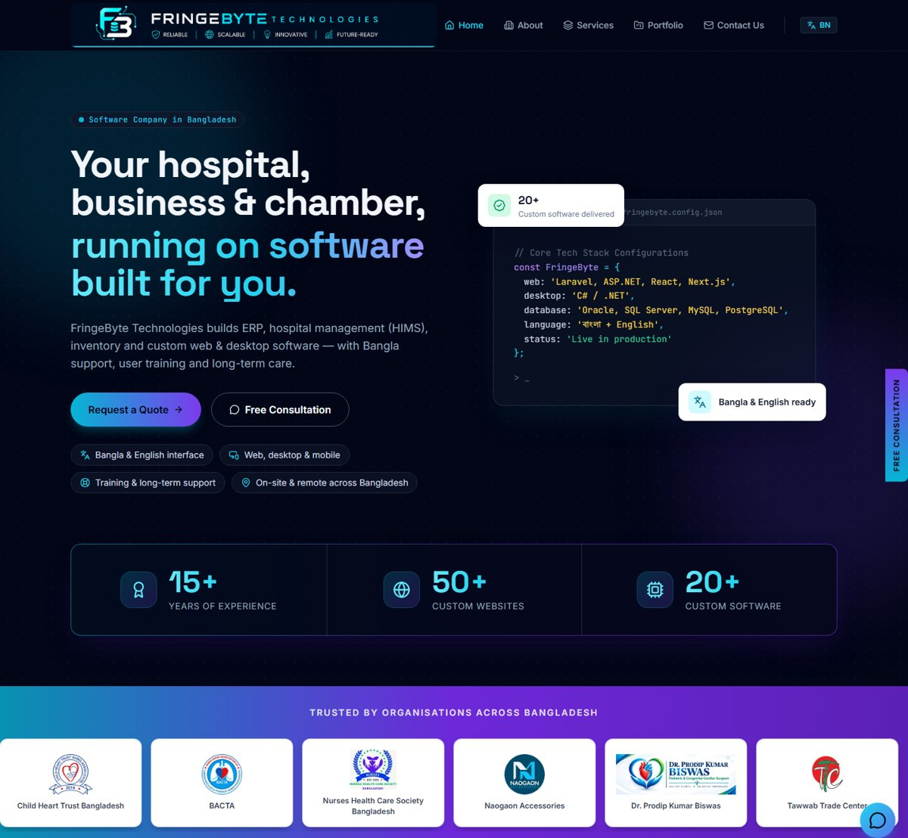
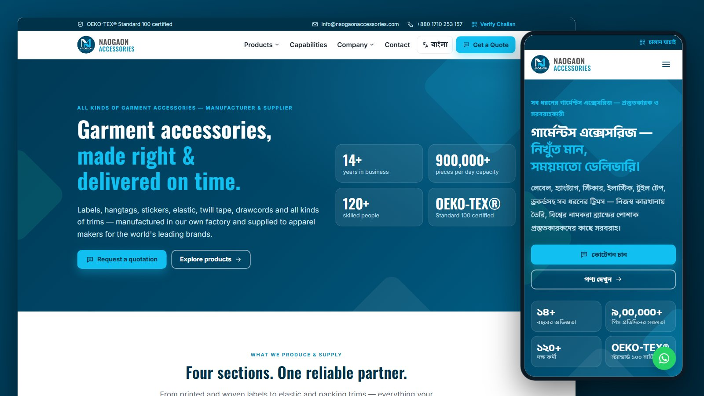
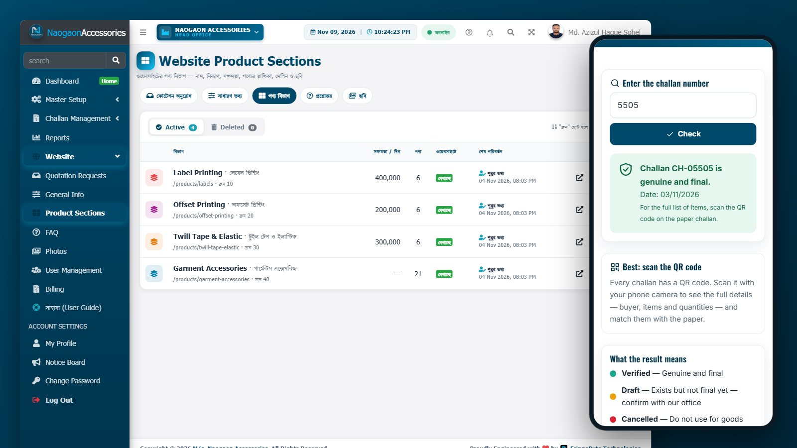
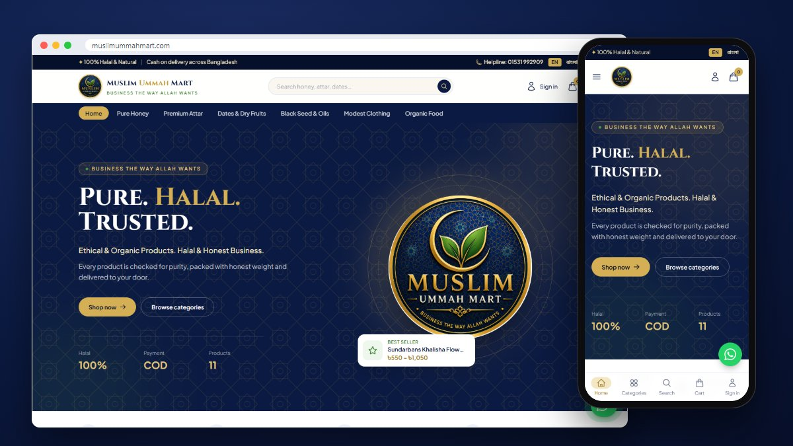
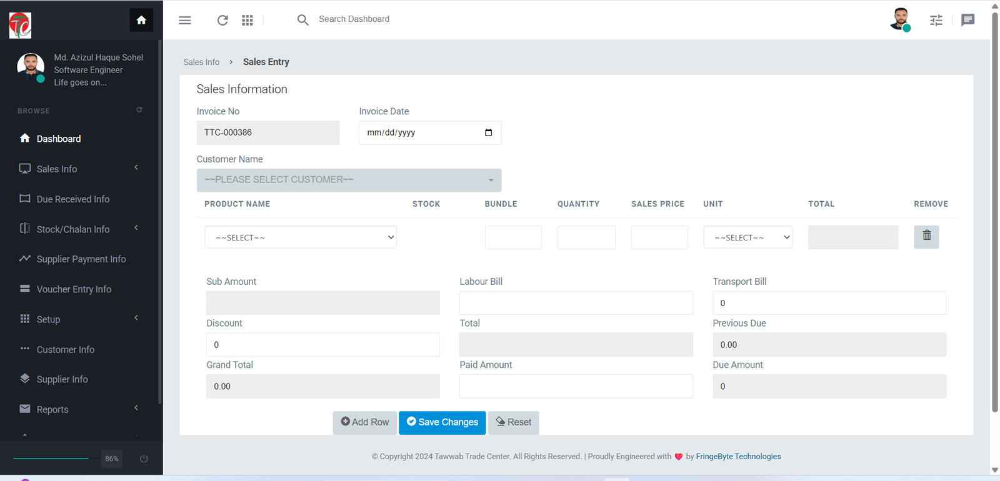

<h1 align="center">Md. Azizul Haque Sohel</h1>
<h3 align="center">Enterprise Software Engineer — C#/.NET · Laravel · ERP · Healthcare Systems</h3>
<p align="center">Founder, <a href="https://fringebytetech.com"><b>FringeByte Technologies</b></a> — custom software, ERP & business automation for Bangladesh and worldwide</p>

<p align="center">
  
  <a href="https://fringebytetech.com"></a>
  <a href="https://fringebytetech.com/services"></a>
</p>

<p align="center">
I design and build <b>scalable, secure, data-driven software systems</b> for organizations that need<br/>
more than a simple website — enterprise ERPs, HIMS, financial platforms, and business automation.
</p>

<p align="center"><i>Turning complex business processes into reliable software systems.</i></p>

<p align="center">
  
  
  
  
</p>
<p align="center">
  
  
  
</p>
<p align="center">
  
  
  
  
</p>

---

## 🌐 [fringebytetech.com](https://fringebytetech.com) — my company website, built end to end

<a href="https://fringebytetech.com"></a>

Designed, engineered and run by me as a production showcase of how I build for clients:

- **Stack:** Laravel 13 · PHP 8.5 · Tailwind CSS · Alpine.js · Vite, deployed on cPanel through a CI-built release branch and a server-side pull deploy
- **Bilingual by design:** separate English and Bangla URLs (`/` and `/bn`) with hreflang, so both languages are indexed by Google
- **SEO-first:** JSON-LD structured data (Organization, Service, FAQ, Breadcrumb), XML sitemap, canonical-host redirects, Google Search Console and Google Business Profile integration
- **Fast:** WebP images with real dimensions (no layout shift), self-hosted fonts, motion that respects reduced-motion settings
- **Secure:** HSTS and security headers, and a spam-hardened contact form (honeypot, signed time-trap, link and disposable-email checks, per-IP and per-sender rate limits)
- **Tested:** 138 automated feature tests guarding every release
- **Real proof:** [live case studies](https://fringebytetech.com/services) for every client project below, with privacy-blurred screenshots and real outcomes

---

## 🚀 What I Build

| Domain | Solutions |
|---|---|
| 🏥 **Healthcare** | HIMS, e-Prescription, OPD, Diagnostics, Billing, Hospital Operations |
| 💰 **Finance & Microfinance** | Loan/EMI Engines, Deposit Ledgers, Treasury & Income Distribution |
| 🏢 **ERP & Business** | Multi-tenant ERP, Accounts, Workflow & Approval Systems |
| 📦 **Inventory & Supply Chain** | Stock, Warehouse, Purchase/Sales, Manufacturing Operations, QR-Verifiable Delivery Challans |
| 🏭 **Garments & Export Manufacturing** | Bilingual Export-Buyer Websites with RFQ Pipelines, Website + ERP on One Platform |
| 🎓 **Institutions** | University, NGO, Association & Corporate Management Systems |
| 📊 **Research & M&E** | KoBoToolbox-based Field Data Collection & Offline Data Systems |
| 🛒 **E-commerce** | Branded Online Stores, Installable (PWA) Shopfronts, Bilingual Store Admin with Team Roles & Audit Trail |
| 🌐 **Web Platforms** | Corporate Websites, Portals & Custom Business Applications |

---

## 🎯 Core Expertise

| Area | Focus |
|---|---|
| **System Architecture** | Multi-tenant ERP design, role-based access control, transactional financial ledgers |
| **Financial & Accounting Logic** | CapEx/OpEx separation, treasury reconciliation, multi-cohort income-distribution engines, audit-safe ledgers |
| **Desktop Applications** | High-performance C# .NET systems on Oracle / SQL Server for large institutions |
| **Enterprise Web** | Laravel-based ERPs with SMS/email automation, PDF reporting, and secure document handling |
| **Database Engineering** | Schema design, query optimization, data migration & reconciliation for financial systems |
| **Security** | Authenticated document storage, role-gated approval workflows, audit-safe transaction states |
| **Institutional Websites** | Custom website & software solutions for any institution — schools, NGOs, associations, and corporate bodies |
| **Research & M&E Data Systems** | KoBoToolbox-based mobile/offline data collection and entry systems for field research and monitoring & evaluation projects |

---

## 🖥️ Desktop Enterprise Systems
*(C# .NET | Oracle | SQL Server)*

| Project | Description |
|---|---|
| **University of Dhaka — Electric Billing System** | Automated utility consumption tracking, custom tariff calculation, and a multi-department billing engine. |
| **NITOR Hospital — Nursing Department Software** | Workforce scheduling, administrative operations, and clinical workflow management for the National Institute of Traumatology & Orthopaedic Rehabilitation. Extended into a full **Hospital Management System** covering end-to-end clinical and administrative workflows. |
| **Pharmacy & Canteen Management System** | Real-time inventory and sales tracking for institutional pharmacy/canteen operations. |

---

## 🌐 Enterprise Web & ERP Systems

### 🏥 Healthcare
- **National Heart Foundation Hospital & Research Institute — Hospital Management System** · *Internal system, in active development*
  Ongoing ASP.NET Core + React/Next.js HMIS build for one of Bangladesh's leading specialized cardiac hospitals — covering patient records, clinical, and administrative workflows for day-to-day hospital operations.
- **CHTB HIMS** *(Child Heart Trust Bangladesh — Hospital Information Management System)* · *Private deployment* · [Case Study](https://fringebytetech.com/services/hospital-management-software#case-study)
  End-to-end pediatric hospital platform: OPD patient registration with PVC ID card printing (registration-fee revenue tracked separately from consultation income) and a hybrid printing pipeline — a local polling agent for true silent, driverless printing at the counter PC, with one-click print fallbacks engineered for reliability on shared hosting; doctor/chamber management with manual and automatic percentage-based revenue-share ledgers; an e-prescription canvas with smart searchable symptom/diagnosis/drug tag-inputs (including inline on-the-fly medicine-library additions) and dosage/duration matrices backed by a 20,000+ item medicine formulary; crash-resilient browser-side draft auto-save across OPD ticketing and patient registration; diagnostic-test ordering with integrated, percentage-based doctor/lab revenue-share billing; QR-verifiable patient ID cards and e-prescriptions with unguessable token-based public/staff-gated detail tiers, built to survive future domain migrations; a pluggable multi-source income-reporting engine with trend charts, pending-revenue indicators, CSV exports, and branded paginated A4 letterhead reports, unified under a single Reports & Analytics hub alongside OPD/test-order/card-print audit logs; a live, auto-refreshing analytics dashboard with trend indicators, doctor workload, and follow-up tracking; a complete in-app Bangla-language user manual; and live multi-site LAN deployment on a shared, security-hardened cloud PostgreSQL database.
- **NHCSBD MIMS — Somiti ERP & Microfinance Engine** · [Live](https://nhcsbd.org) · [Case Study](https://fringebytetech.com/services/erp-software#case-study)
  Laravel-based multi-cohort ("Phase") member finance platform for a nurses' welfare society: deposit ledgers with proof-of-payment verification, an EMI loan disbursement & bulk-repayment engine, phase-based income-distribution with automated member-credit accounting, a CapEx/OpEx-aware treasury engine separating capital investment from operating spend, an organization-wide financial-transparency ledger with role-gated visibility, QR-verifiable member financial statements (deposit, income-share, and combined account ledgers) with signed-link tamper verification, a live analytics dashboard with collection-trend charting, dynamic Others-Income & Donation modules, role-based Admin/Accountant/Super-Admin approval chains, resilient post-response SMS/email dispatch (no background queue-worker dependency), and hardened private-storage handling for sensitive member documents.
- **BACTA** *(Bangladesh Association of Cardiovascular & Thoracic Anesthesiologists)* · [Live](https://bactabd.org) · [Case Study](https://fringebytetech.com/services/website-development#case-study)
  National medical registry and multi-tier ERP built on Laravel 13 — role-gated admin panel with soft-delete data protection across every content table, automated encrypted daily backups, an admin-managed homepage promotional banner system, a member-application intake pipeline with secretariat approval workflow, a national surgical statistics registry (overall/congenital/valvular procedure tracking by hospital & year), and a full academic journal & clinical-guidelines publication archive.

- **Dr. Prodip Portfolio & Smart Prescription System** · [Live](https://drpkb.nhcsbd.org) · [Case Study](https://fringebytetech.com/services/doctor-website-e-prescription#case-study)
  Laravel 13 platform for a pediatric cardiac surgery practice, pairing a public doctor-portfolio site with a full e-prescription clinic-management backend: patient registry with guardian-phone/name+DOB duplicate detection, a daily-reset Visit/Token queue with POS-style receipt printing, a structured prescription canvas (reusable clinical-term dictionaries, saved presets, searchable medicine/dosage pickers, Plain-Paper/Letterhead-Pad print modes) and QR-code-verifiable digital prescriptions with a public no-login verification page. Built with a medico-legal-safe editing model — same-day in-place correction only, with an explicit, separately-styled "Follow-Up as New Rx" path so a later visit always creates a new record instead of silently overwriting history, idempotency-protected double-submit guarding, and concurrent-edit conflict detection — plus role-based access (Doctor/Super Admin/PA), a patient-history timeline embedded on the Rx-writing screen, and Asia/Dhaka-timezone-correct reporting.

### 🏭 Manufacturing & Supply Chain
- **M/s. Naogaon Accessories — Bilingual Corporate Website + Delivery-Challan ERP** · *Private deployment · corporate site launching soon* · [Case Study](https://fringebytetech.com/services/garment-manufacturing-erp-software#case-study)
  One Laravel 13 / PHP 8.5 / PostgreSQL 18 codebase that runs both the public face and the back office of an OEKO-TEX®-certified garment-accessories manufacturer (labels, hangtags, twill tape & elastic) that supplies apparel makers for global retail brands.
  - **Export-buyer website (English + Bangla)** built to win RFQs from foreign buyers: product sections with daily capacities and made-in-house vs. supplied badges, factory capabilities, compliance & certificate page, buyer-markets page, FAQ, and a "Get a Quote" form on every page. Mobile-first, fast (WebP image pipeline, self-hosted fonts) and SEO-ready — schema.org structured data, sitemap, hreflang, breadcrumbs.
  - **Website managed from the ERP — no developer needed:** company details, homepage text, product sections, FAQ, photos and buyer lists are edited in the back office and go live on save, with full change history and restore.
  - **RFQ pipeline:** quote requests (with tech-pack / artwork uploads) land in the ERP with a header notification bell, status tracking (new → in progress → quoted → closed), one-tap WhatsApp/email/call replies, and private file storage. Bot-proofed with a honeypot, signed time-stamps, origin checks and rate limiting — no annoying CAPTCHA.
  - **QR-verifiable delivery challans:** every challan carries a QR code; receiving factories can also confirm a challan on a public verify page (even typed in Bangla digits) that shows only status and date — never buyer, factory or item details.
  - **Challan & multi-factory operations** with role-based permissions, audit trail on every change, soft delete + restore, and optimistic locking so two users can't silently overwrite each other.
  - **Built to hand over:** a complete in-app Bangla user manual and 170+ automated tests guarding every release.

  
  
- **Prime Global Manufacturing Ltd.** · [Live](https://primeglobalmfg.com)
  Global corporate portal for an apparel sourcing hub operating across Bangladesh & Hong Kong.
- **Karpas Bangla International** · *Delivered · site no longer online*
  Portal for a textile, RMG apparel, and jute-products export-sourcing center.
- **Web-Based Inventory & Stock Management System** · *Private deployment*
  Real-time stock tracking, multi-warehouse inventory valuation, reorder alerts, and automated purchase/sales analytics.

### 🛒 Trading & Retail
- **Muslim Ummah Mart — E-commerce Store + Bilingual Store Admin** · [Live](https://muslimummahmart.com) · [Case Study](https://fringebytetech.com/services/ecommerce-website-development#case-study)
  Laravel 13 / PHP 8.5 / PostgreSQL 18 online store with a Filament 5 back office, built to be run by the shop's own staff — live on its own domain since November 2026.
  - **Storefront:** designed from the brand's own logo, with category browsing, fast search, product variants with price ranges and discount badges, a one-tap WhatsApp chat button, and a mobile-first design that installs on phones as an app (PWA) with a bottom navigation bar and an offline page.
  - **Bilingual catalog & admin:** every product, category and variant stored in English and Bangla; the admin panel switches language in one tap.
  - **Protected sign-in:** branded admin login with its own session guard (separate from customer accounts), a sign-in log, a welcome notice showing the previous sign-in, an email alert from any new device, self-service Change / Forgot password (strength checklist, signs out other devices, no account discovery), and optional two-step verification.
  - **Marketing popups:** offers and announcements managed by the shop — bilingual banner, button and schedule (starts/stops on its own), once-a-day frequency remembered in the visitor's browser, a bottom sheet on phones, and a signed admin-only preview.
  - **Built to hand over:** an in-panel Bangla user guide that shows each role only what it can do, and branded bilingual error pages with a support reference that maps to the exact log entry — no stack traces, ever.
  - **Team management:** staff join through signed, single-use, 48-hour email invitations and set their own strong password; Owner / Manager / Staff roles with permission policies; employee IDs issued from a database sequence, so simultaneous entries never collide.
  - **Audit-safe data:** every table records who created, edited and deleted each row and when, deletes are soft (restorable, never permanent), and a change history shows what changed.
  - **Fast at scale:** indexed foreign keys, trigram indexes for partial-word product search, and case-insensitive unique constraints that stop duplicates even under concurrent entry.
  - **Shipped like a product:** security headers and rate limits, 155+ automated tests, and a CI pipeline that tests, builds and publishes a release branch that the cPanel server pulls automatically.

  <a href="https://muslimummahmart.com"></a>
- **M/s. Tawwab Trade Center — Stock, Sales & Accounts System** · *Private deployment, live since September 2024* · [Case Study](https://fringebytetech.com/services/inventory-accounting-software#case-study)
  Replaced a trading center's paper registers with one PHP/MySQL system that runs its day-to-day business: two sales-invoice workflows built around how the business actually bills (bundle and quantity, labour and transport charges, discount, previous due carried forward), stock-in and chalan entry with a live stock list, a dedicated customer due-collection module with money receipts, supplier payments and ledgers, expense vouchers, and a full chart of accounts (account groups, heads, payees and banks). Customers get an automatic SMS on every sale and due payment showing total, paid and remaining due, with every message and its cost logged. Printable invoices, chalans, customer and supplier ledgers, and date-wise sales and cash-collection reports, backed by SQL reporting views. In 2026 the system was security-hardened without disrupting daily use: passwords moved to bcrypt with transparent upgrade on next login, credentials pulled out of the code into a separate config, and login switched to prepared statements.

  

### 🏗️ Construction & Real Estate
- **Prolific Builders (Pvt.) Ltd.** · [Live](https://prolificbd.org)
  Corporate portal for a construction management, engineering design, and strategic supply firm.
- **Real Estate Management System** · [Live Demo](http://hchousingltd.com)

### 🏨 Hospitality & IT Services
- **Hotel Grand Safeer** · [Live](https://hotelgrandsafeer.com)
  Booking platform for a luxury hotel in Jamalpur, Bangladesh.
- **Glory IT Solutions** · [Live](https://gloryitsolutions.com)
  Portal for a global IT solutions, DevOps, and cloud infrastructure consultancy (Bangladesh & USA).

---

## 📊 Engineering Philosophy

```text
Business Problem → Requirement Analysis → System Architecture → Database Design
       → Secure Implementation → Testing & Optimization → Deployment → Continuous Improvement
```

I don't just build features — I build systems that are **Reliable · Maintainable · Secure · Scalable · Business-focused**.

---

## 📌 Featured Repositories

🔹 [FringeByte Technologies — company website (Laravel 13, bilingual, SEO-first)](https://fringebytetech.com)

🔹 [BACTA — Medical Association ERP](https://bactabd.org)

🔹 [Glory IT Solutions](https://github.com/azizulbcse/gloryitsolutions)

---

## 🤝 Let's Build Something Useful

I'm interested in challenging software projects involving Enterprise Software, ERP Systems, Healthcare/HIMS, Financial Applications & Microfinance, Inventory & Supply Chain, Institutional Software, and Business Automation.

- 🌐 **Company:** [FringeByte Technologies](https://fringebytetech.com) — see case studies and request a demo
- 📧 **Email:** [azizulbcse@gmail.com](mailto:azizulbcse@gmail.com)
- 💼 **LinkedIn:** [Md. Azizul Haque Sohel](https://www.linkedin.com/in/azizulhaquesohel/)
- 📱 **WhatsApp:** [+880 1728-226580](https://wa.me/8801728226580)
- 🏥 **Full-time Role:** Software Engineer, National Heart Foundation Hospital & Research Institute — open to freelance/contract work alongside

<p align="center"><i>Engineering high-quality, scalable solutions for complex business challenges.</i></p>
